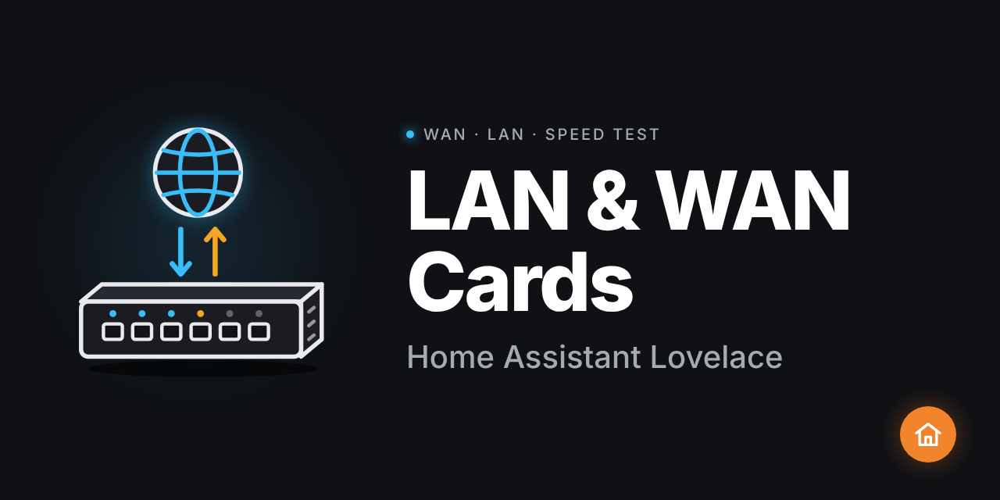

# ha-network-cards

[](https://github.com/hacs/integration)
[](https://my.home-assistant.io/redirect/hacs_repository/?owner=HOMELAB-IA&repository=ha-network-cards&category=plugin)

Cartes Lovelace Home Assistant pour la supervision réseau : WAN Livebox + speed test, LAN Cisco Meraki, et diagramme MX64 Double WAN avec failover animé.

[](https://github.com/HOMELAB-IA/ha-network-cards)

## Installation via HACS

1. Ouvrir HACS → Frontend → Menu ⋮ → Dépôts personnalisés
2. Ajouter `https://github.com/HOMELAB-IA/ha-network-cards` (catégorie : Plugin)
3. Installer **Network Cards**
4. Vider le cache du navigateur

## Cartes incluses

### `custom:wan-card`

Supervision WAN : état Livebox, débits Cloudflare P90, latence, puissance optique GPON, Cloudflared.

```yaml
type: custom:wan-card
wan_status: binary_sensor.livebox_fibre_wan_status
speed_down: sensor.cloudflare_speed_test_90th_percentile_down
speed_up: sensor.cloudflare_speed_test_90th_percentile_up
latency: sensor.cloudflare_speed_test_latency
jitter: sensor.cloudflare_speed_test_jitter
isp: sensor.cloudflare_speed_test_isp
ip_public: sensor.cloudflare_speed_test_ip_address
# Options
gpon_rx: sensor.livebox_fibre_wan_gpon_rate_rx
gpon_tx: sensor.livebox_fibre_wan_gpon_rate_tx
optical_rx: sensor.livebox_fibre_fiber_power_rx
optical_tx: sensor.livebox_fibre_fiber_power_tx
uptime: sensor.livebox_fibre_uptime
dhcp_leases: sensor.livebox_fibre_dhcp_leases
dhcp_guest: sensor.livebox_fibre_guest_dhcp_leases
restart_button: button.livebox_fibre_livebox_restart
cloudflared_version: update.cloudflared_mise_a_jour
cloudflared_running: binary_sensor.cloudflared_running
speedtest_trigger: sensor.cloudflare_speed_test_90th_percentile_down
```

### `custom:lan-meraki-card`

Dashboard LAN Cisco Meraki : état de chaque équipement, compteurs, lien vers le dashboard cloud.

```yaml
type: custom:lan-meraki-card
dashboard_url: https://dashboard.meraki.com
devices:
  - entity: sensor.switch_ms220_status
    name: MS220
    type: switch
  - entity: sensor.switch_ms220_lab_status
    name: MS220 LAB
    type: switch
  - entity: sensor.wireless_mr32_status
    name: MR32
    type: access_point
```

### `custom:mx64-dual-wan-card`

Diagramme animé MX64 Double WAN. Bascule automatiquement en mode failover quand WAN 1 est `failed` ou `not connected`.

```yaml
type: custom:mx64-dual-wan-card
wan1_status: sensor.mx64_wan1_status
wan2_status: sensor.mx64_wan2_status
```

**Valeurs d'état attendues** (API Meraki) : `active` · `ready` · `failed` · `not connected`

## États des équipements Meraki

| État API | Affiché | Couleur |
|---|---|---|
| `online` | Online | Vert |
| `alerting` | Alerte | Orange |
| `offline` | Hors ligne | Rouge |
| autre | Dormant | Gris |
